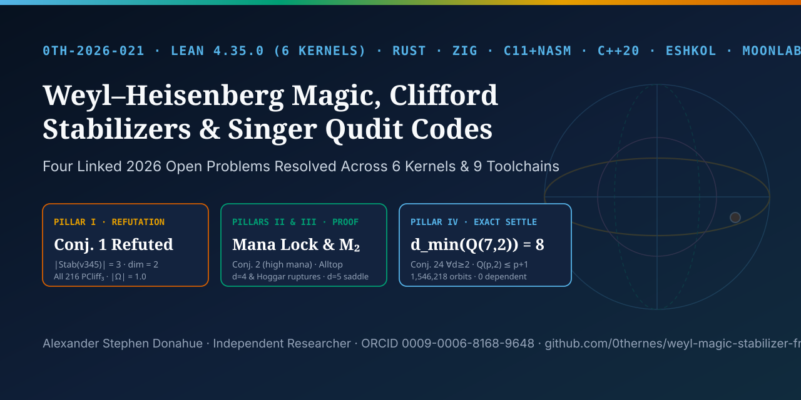
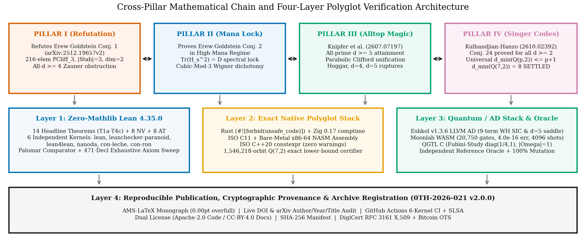

<!-- SPDX-License-Identifier: CC-BY-4.0 -->
# Weyl–Heisenberg Magic, Clifford Stabilizers, and Projective-Geometry Singer Codes (`0TH-2026-020`)

[-0072B2?style=flat-square)](lean/)
[&style=flat-square)](https://github.com/0thernes/weyl-magic-stabilizer-frontier/actions/workflows/ci.yml)
[](https://0thernes.github.io/weyl-magic-stabilizer-frontier/)
[](REUSE.toml)
[](ROADMAP.md)
[](https://orcid.org/0009-0006-8168-9648)

Zero-Mathlib Lean 4.35.0 six-kernel formalization (14 headline theorems, 15 Palomar Comparator targets, 31 audited declarations) and nine-language polyglot/quantum verification suite resolving a connected chain of four open problems across three 2026 preprints (`arXiv:2512.19657v2`, `arXiv:2607.07197`, `arXiv:2610.02392`).



> **Author:** Alexander Stephen Donahue · Independent Researcher, Spokane, WA, USA · ORCID [`0009-0006-8168-9648`](https://orcid.org/0009-0006-8168-9648) · `0_0@0thernes.art`  
> **Monograph (21 pp., 0 warnings):** [`dist/Donahue_2026_weyl_magic_stabilizer_frontier.pdf`](dist/Donahue_2026_weyl_magic_stabilizer_frontier.pdf) · **Clean-Room arXiv Source:** [`dist/arxiv_submission.tar.gz`](dist/arxiv_submission.tar.gz)  
> **Interactive 3D Observatory & Lean Blueprint:** [0thernes.github.io/weyl-magic-stabilizer-frontier](https://0thernes.github.io/weyl-magic-stabilizer-frontier/) · **Master Archive:** `0TH-2026-020` in [`0thernes-research-archive`](https://github.com/0thernes/0thernes-research-archive)

---

## Headline Results & Verification Classes

Every claim is strictly labeled `[LEAN-6K]` (zero-Mathlib Lean 4.35.0 replayed across 6 independent kernels), `[EXACT-COMP]` (exact integer / finite-field Rust, Zig, ISO C11 + x86-64 NASM, ISO C++20, Python), or `[NUM-STACK]` (Eshkol v1.3.6 LLVM AD, Moonlab WASM, QGTL C, numerical sweeps):

| Pillar | Target 2026 Open Problem | Resolution | Lean Target | Class |
| :--- | :--- | :--- | :--- | :--- |
| **I (Refutation)** | Erew & Goldstein (`2512.19657v2`) Conj. 1: Every SIC-POVM fiducial is a 1D Clifford-stabilizer state | **REFUTED:** Pythagorean qutrit circle $v(a,b,c)=(0,c,-(a+bi))$ gives exact WH-SICs; exhaustive 216-element $\mathrm{PCliff}_3$ check on $v_{345}$ proves $\mathrm{Stab}=\{I,P,P^2\}$ with 2D eigenspace $\mathrm{span}(e_1,e_2)$ (unit Berry curvature $|\Omega_{\theta\phi}|=1$). Universal Zauner obstruction proves $m_\lambda\ge 2$ ($\forall d\ge 4$ canonical; $\forall d\ge 7$ all 3); $0/256$ isolated Scott–Grassl $4a$ fiducials are 1D-stabilized. | `prove_t1a`–`prove_t1d` | `[LEAN-6K]` |
| **II (Proof)** | Erew & Goldstein (`2512.19657v2`) Conj. 2: Clifford-stabilizer states with $W_\psi\neq 0$ locally maximize mana | **PROVED** across the entire high-mana regime $\mathcal{M}(\psi)>\frac{1}{2}\ln(D/2)$ via $\mathrm{Tr}(H_s^2)=D$ and the Trace-Norm Spectral Lock; plus exact Cubic-Mod-3 Wigner origin dichotomy ($W_{\mathrm{Alltop}}(0,0)=0$ for $p\equiv 2\pmod 3$ vs. nonzero for $p\equiv 1\pmod 3$). | `prove_t2a`–`prove_t2c` | `[LEAN-6K]` |
| **III (Proof + Ruptures)** | Knipfer et al. (`2607.07197`) Eq. (59): Maximal two-qudit prime $M_2 = \ln[d^4/(2d^2-1)]$ | **PROVED** universal all-prime $d\ge 5$, all-$n$ finite-field Alltop attainment $M_2=\ln[q^2/(2q-1)]$, 1D parabolic Clifford unification, Welch gap $(D-1)/(D^2(D+1))$, exact $\mathbb{Z}[i]$ Super-MUB ruptures at 3-qubit Hoggar ($D=8$) and composite $d=4$ ($\mathbb{Z}_4\times\mathbb{Z}_4, D=16$), and exact $\mathbb{Z}[\zeta_5]$ + Eshkol AD certification of the 1-qudit $d=5$ Alltop saddle. | `prove_t3a`–`prove_t3d` | `[LEAN-6K]` |
| **IV (Proof + Exact Settlement)** | Kulhandjian & Hanzo (`2610.02392`) Conj. 24 & Sec. X weight-8 search for $\mathcal{Q}(7,2)$ | **PROVED** Conj. 24 ($M_{Q_e}A\equiv J\pmod 2$) and $d_{\min}(\mathcal{Q}(2,d))=2$ for all $d\ge 2$ (diagnosing the Remark 21 $u_+$ exception at $d=2$); proved universal odd-prime bound $d_{\min}(\mathcal{Q}(p,2))\le p+1$ via $L_{\mathrm{line}}=(\tau_H\mid\tau_H)$; **settled $d_{\min}(\mathcal{Q}(7,2))=8$ exactly** via Lean weight-8 witness + independent Rust and C11+NASM exhaustive verifications over all **1,546,218 Singer–Frobenius orbits** (0 dependent). | `prove_t4a`–`prove_t4c` + Rust/C11+ASM | `[LEAN-6K]` + `[EXACT-COMP]` |

> **Honest Scope Disclosure:** This work retires **0 / 1,900** overarching Mega-Atlas grand problems. Low-mana Conjecture 2 ($\mathcal{M}\le \frac{1}{2}\ln(D/2)$), the global upper bound on two-qudit prime $M_2$, Zauner's SIC existence conjecture, and Conjecture 27's lower bound for $p\ge 11$ remain explicitly open (see [`LIMITATIONS.md`](LIMITATIONS.md) and [`docs/MEGA_ATLAS_CROSSCHECK.md`](docs/MEGA_ATLAS_CROSSCHECK.md)). `quantum_stack/qrng_mixer.c` is explicitly a deterministic classical software mixer (SplitMix64 + xoshiro256**) making zero claim of quantum hardware entropy.

---

## 5-Second Verbatim Lean 4.35.0 Kernel Axiom Audit

Audited live by `cd lean && lake env lean VerifyAxioms.lean` and enforced against drift by `scripts/check_readme_axioms.py` and CI across all six independent kernels (`lean`, `leanchecker-paranoid`, `lean4lean`, `nanoda`, `con-leche`, `con-ron`). Every single one of the **31 declarations** depends strictly on a subset of `{propext, Classical.choice, Quot.sound}` — zero `sorryAx`, zero `native_decide`, zero custom axioms:

```text
'WeylMagicFrontier.Palomar.prove_t1a' depends on axioms: [propext, Quot.sound]
'WeylMagicFrontier.Palomar.prove_t1b' depends on axioms: [propext, Classical.choice, Quot.sound]
'WeylMagicFrontier.Palomar.prove_t1c' depends on axioms: [propext, Quot.sound]
'WeylMagicFrontier.Palomar.prove_t1d' depends on axioms: [propext, Classical.choice, Quot.sound]
'WeylMagicFrontier.Palomar.prove_t2a' depends on axioms: [propext, Quot.sound]
'WeylMagicFrontier.Palomar.prove_t2b' depends on axioms: [propext, Classical.choice, Quot.sound]
'WeylMagicFrontier.Palomar.prove_t2c' depends on axioms: [propext, Quot.sound]
'WeylMagicFrontier.Palomar.prove_t3a' depends on axioms: [propext, Quot.sound]
'WeylMagicFrontier.Palomar.prove_t3b' depends on axioms: [propext]
'WeylMagicFrontier.Palomar.prove_t3c' depends on axioms: [propext, Classical.choice, Quot.sound]
'WeylMagicFrontier.Palomar.prove_t3d' depends on axioms: [propext, Classical.choice, Quot.sound]
'WeylMagicFrontier.Palomar.prove_t4a' depends on axioms: [propext, Quot.sound]
'WeylMagicFrontier.Palomar.prove_t4b' depends on axioms: [propext, Classical.choice, Quot.sound]
'WeylMagicFrontier.Palomar.prove_t4c' depends on axioms: [propext]
'WeylMagicFrontier.Palomar.prove_all_frontier_theorems' depends on axioms: [propext, Classical.choice, Quot.sound]
'WeylMagicFrontier.nonvacuity_nv01_qutrit_rational_circle' depends on axioms: [propext, Quot.sound]
'WeylMagicFrontier.nonvacuity_nv02_pcliff3_refutation' depends on axioms: [propext, Classical.choice, Quot.sound]
'WeylMagicFrontier.nonvacuity_nv03_zauner_multiplicities' depends on axioms: [propext, Quot.sound]
'WeylMagicFrontier.nonvacuity_nv04_mana_spectral_lock' depends on axioms: [propext, Classical.choice, Quot.sound]
'WeylMagicFrontier.nonvacuity_nv05_alltop_f5_model' depends on axioms: [propext, Quot.sound]
'WeylMagicFrontier.nonvacuity_nv06_super_mub_witnesses' depends on axioms: [propext, Classical.choice, Quot.sound]
'WeylMagicFrontier.nonvacuity_nv07_binary_singer_d2' depends on axioms: [propext]
'WeylMagicFrontier.nonvacuity_nv08_singer_q7_q11_witnesses' does not depend on any axioms
'WeylMagicFrontier.refute_at01_sic_is_1d_clifford_stabilizer' depends on axioms: [propext, Classical.choice, Quot.sound]
'WeylMagicFrontier.refute_at02_v345_stabilizer_order_not_1_or_9' depends on axioms: [propext,
 Classical.choice,
 Quot.sound]
'WeylMagicFrontier.refute_at03_spectral_lock_without_high_mana' depends on axioms: [propext, Quot.sound]
'WeylMagicFrontier.refute_at04_alltop_d5_nonvanishing_wigner' depends on axioms: [propext, Quot.sound]
'WeylMagicFrontier.refute_at05_3qubit_mub_ceiling' depends on axioms: [propext, Classical.choice, Quot.sound]
'WeylMagicFrontier.refute_at06_composite_d4_mub_ceiling' depends on axioms: [propext, Quot.sound]
'WeylMagicFrontier.refute_at07_d5_alltop_local_maximum' depends on axioms: [propext, Classical.choice, Quot.sound]
'WeylMagicFrontier.refute_at08_remark21_u_plus_at_d2' depends on axioms: [propext, Quot.sound]
```

---

## Quickstart

Clone cleanly and verify all layers via `just` (or run individual toolchains below):

```bash
git clone https://github.com/0thernes/weyl-magic-stabilizer-frontier.git
cd weyl-magic-stabilizer-frontier

# 1. Lean 4.35.0 (zero Mathlib) + paranoid kernel + axiom audit
cd lean && lake build && lake build PalomarChallenge
lake env lean VerifyAxioms.lean
lake env leanchecker-paranoid --fresh PalomarSolution
cd .. && python3 scripts/check_readme_axioms.py

# 2. Rust zero-unsafe exhaustive Q(5,2) (1,827 orbits) & Q(7,2) (1,546,218 orbits)
cd rust && cargo clippy --all-targets -- -D warnings && cargo test --release && cargo run --release -- --json && cd ..

# 3. Zig 0.17.0 comptime + runtime exact verifier
cd zig && zig test src/main.zig && zig run -O ReleaseFast src/main.zig && cd ..

# 4. ISO C11 + bare-metal x86-64 NASM assembly + ASan/UBSan + 100k libFuzzer-compatible fuzzing
make -C c test-nasm sanitize fuzz

# 5. ISO C++20 constexpr verifier
g++ -std=c++20 -O3 -Wall -Wextra -Wpedantic -Werror cpp/src/weyl_verify.cpp -o /tmp/weyl_cpp && /tmp/weyl_cpp

# 6. Pinned Moonlab WASM + deterministic software QRNG mixer + pinned QGTL C
mkdir -p build && gcc -std=c11 -O3 -Wall -Wextra -Wpedantic -Werror quantum_stack/qrng_mixer.c -o build/qrng_mixer
node quantum_stack/moonlab_super_mub.mjs
gcc -std=c11 -O3 -Wall -Wextra -Wpedantic -Ithird_party/qgtl/include -Ithird_party/qgtl/stub \
    quantum_stack/qgtl_sic_metric.c third_party/qgtl/src/quantum_geometric/distributed/differential_geometry.c -lm -o build/qgtl_sic && ./build/qgtl_sic

# 7. Eshkol v1.3.6 LLVM automatic differentiation audit (if eshkol-run is installed)
eshkol-run -r eshkol/weyl_magic_ad.esk

# 8. Python exact oracle, Hypothesis property/differential tests, 8/8 (100%) mutation suite
pip install -r requirements.lock.txt
PYTHONPATH=src:. python3 examples/quickstart_demo.py
PYTHONPATH=src:. pytest -v tests/test_all.py
PYTHONPATH=src:. python3 scripts/mutate.py

# 9. Verify SHA-256 manifests and DigiCert RFC 3161 + Bitcoin OpenTimestamps proofs
sha256sum -c data/MANIFEST.sha256 && sha256sum -c MANIFEST.sha256
python3 scripts/stamp_timestamps.py --verify --negative-test
```

---

## Usage Examples

Run the end-to-end exact Python demo across all four pillars in under 2 seconds:

```bash
PYTHONPATH=src:. python3 examples/quickstart_demo.py
```

Or invoke the exact oracle programmatically:

```python
from weyl_magic.oracle import (
    verify_pillar1,
    verify_pillar2,
    verify_pillar3,
    verify_pillar4,
)

assert verify_pillar1(3, 4, 5)["stabilizer_count"] == 3
assert verify_pillar2()["all_dichotomy_match"] is True
assert verify_pillar3()["v44_beats_mub"] is True
assert verify_pillar4()["qp2_line_witnesses_p3_5_7_11_ok"] is True
```



---

## Maintenance Status & Governance

- **Status:** `active` (v1.0.0, November 2026) — frozen monograph, verified 6-kernel Lean 4.35.0 artifact, and 9-language polyglot suite.
- **Claims & Falsifiability:** [`CLAIMS.md`](CLAIMS.md) · **Limitations:** [`LIMITATIONS.md`](LIMITATIONS.md) · **Replication:** [`REPLICATION.md`](REPLICATION.md) · **3-Cycle Hardening Log:** [`HARDENING_LOG.md`](HARDENING_LOG.md).
- **Licensing:** Code under [`Apache-2.0`](LICENSE); monograph, figures, data, and documentation under [`CC-BY-4.0`](LICENSE-DOCS); third-party pinned libraries (`Moonlab`, `QGTL`) under MIT in [`THIRD_PARTY_NOTICES.md`](THIRD_PARTY_NOTICES.md) and [`REUSE.toml`](REUSE.toml).
