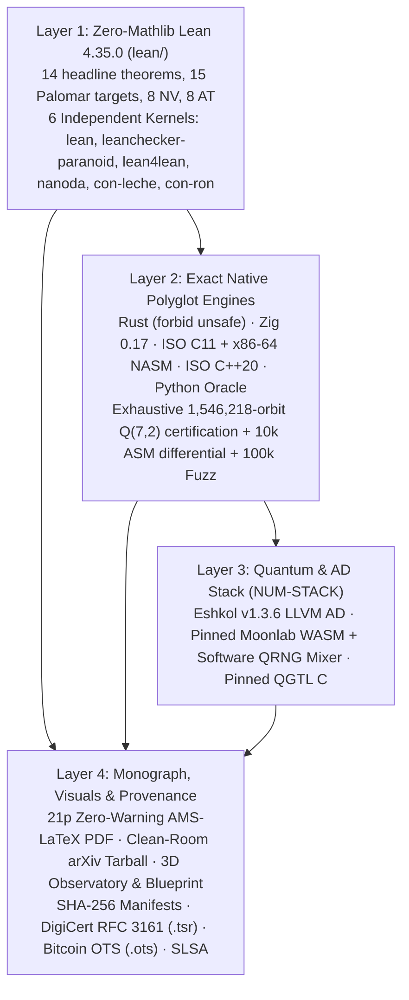

<!-- SPDX-License-Identifier: CC-BY-4.0 -->
# System & Proof Architecture (`docs/architecture.md`)

`weyl-magic-stabilizer-frontier` (`0TH-2026-021`) separates its formal trust base, exact native verification, physical/differential-geometry cross-checks, and publication provenance into four clean, independently auditable layers.

## Directory Map
- `lean/` — Zero-Mathlib Lean 4.35.0 project (`WeylMagicFrontier/{Cyclotomic,Pillar1..4,NonVacuity,AdversarialTests}.lean`, `Challenge.lean`, `PalomarChallenge.lean`, `Solution.lean`, `PalomarSolution.lean`, `VerifyAxioms.lean`, `comparator.json`).
- `rust/` — Stdlib-only `#![forbid(unsafe_code)]` exact verifier (`Cargo.toml`, `Cargo.lock`, `src/main.rs`).
- `zig/` — Zig 0.17.0 `comptime` + runtime exact verifier (`src/main.zig`).
- `c/` & `asm/` — Strict ISO C11 (`src/weyl_verify.c`), libFuzzer-compatible fuzzer (`src/fuzz_singer.c`), `Makefile`, and dual-ABI x86-64 NASM assembly kernel (`asm/gf7_singer_kernel.asm`).
- `cpp/` — Strict ISO C++20 `constexpr` `static_assert` verifier (`src/weyl_verify.cpp`).
- `eshkol/` — Eshkol v1.3.6 LLVM automatic differentiation verification (`weyl_magic_ad.esk`).
- `quantum_stack/` & `third_party/` — Pinned Moonlab WASM (`third_party/moonlab/`), deterministic software QRNG mixer (`qrng_mixer.c`), Moonlab Super-MUB harness (`moonlab_super_mub.mjs`), and pinned QGTL C harness (`qgtl_sic_metric.c`, `third_party/qgtl/`).
- `src/`, `reference/`, `tests/`, `examples/`, `scripts/` — Exact Python oracle, Hypothesis property + differential tests, 8/8 mutation suite, figure generator, Blueprint builder, live citation auditor, axiom drift guard, manifest/timestamp scripts, and Build Standard v1.2.0 audit scripts.
- `paper/` & `dist/` — 21-page AMS-LaTeX monograph (`main.tex`, `refs.bib`, `figures/fig1..5.{pdf,png}`), frozen compiled PDF, and clean-room `arxiv_submission.tar.gz`.
- `docs/` — Documentation, ADRs, red-team audit, run-log, Mega-Atlas crosscheck, statement-fidelity audit, and zero-CDN GitHub Pages site (`docs/site/{index.html,blueprint.html}`).
